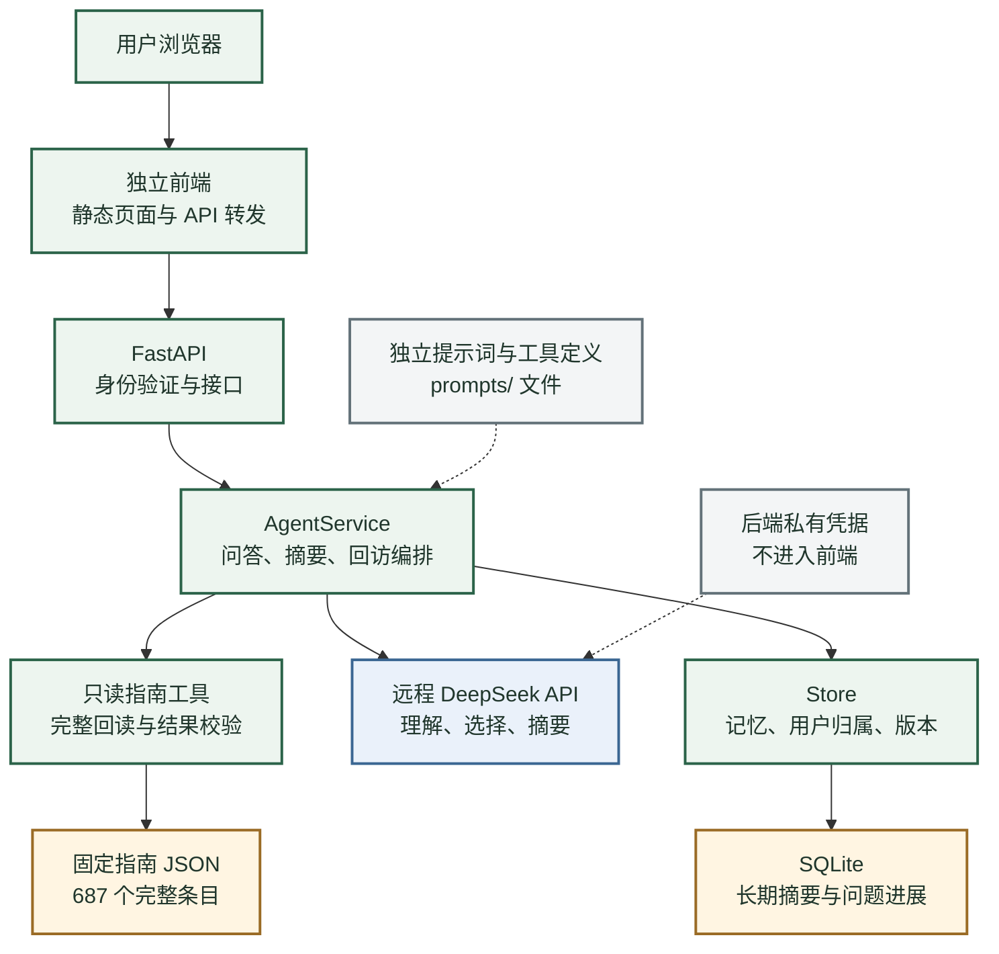
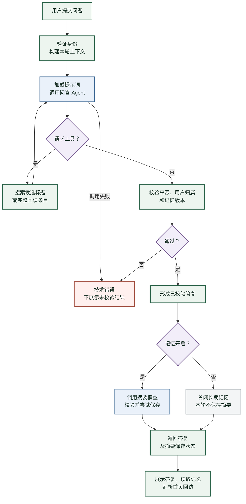
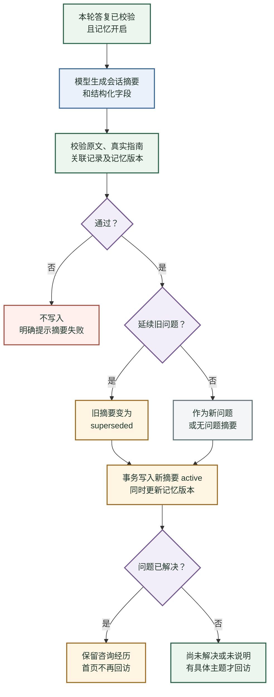
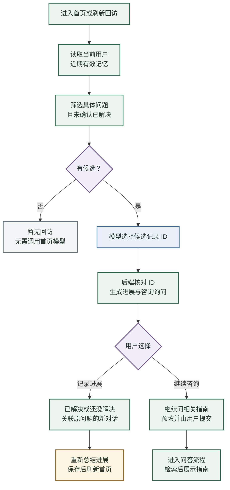

# 苟活项目架构与流程说明

版本：Python 独立版 v1.0 · 2026-10-13 · 面向产品、研发与测试团队

苟活围绕用户的生活困扰查询固定指南，结合用户明确表达的状态选择适用条目；每轮对话结束时生成长期摘要，用户下次回来时先询问问题进展，再由用户决定是否继续咨询指南。当前采用独立前端、Python 后端和远程模型 API，支持本地及单机 Docker 部署。

## 1 先把产品讲清楚

用户一次提问得到的价值是：找到与当前问题相关、能够追溯到指南原文的条目。开启记忆后，用户无需反复交代同一个问题的背景；首页会问“上次的问题解决了吗”“还需要继续问相关指南吗”，让后续咨询接上之前的经历。

产品围绕一个完整循环工作：**提出问题 → 查指南 → 获得有来源的答复 → 自动保存摘要 → 下次回来询问进展 → 用户选择记录进展或继续咨询。**

| 用户动作 | 当前产品行为 | 用户能检查什么 |
|---|---|---|
| 提出具体困扰 | 理解问题、搜索指南、完整回读，再返回适用条目 | 指南原文摘要、成本、证据、限制和来源 |
| 开启长期记忆 | 每轮已校验答复后，模型生成摘要并由后端校验保存 | 状态、问题、咨询过的指南、问题进展 |
| 回到首页 | 询问尚未确认解决的问题及是否继续咨询 | 回访所指的是哪一次问题 |
| 点击已解决或还没解决 | 发起关联原问题的新一轮对话，自动更新进展摘要 | 新摘要和保留的旧摘要 |
| 纠正、删除或关闭记忆 | 更新记录或停止长期读写，使旧请求版本失效 | 可纠正的摘要与开关状态 |

“个性化”主要体现在问题理解和条目选择上。实质建议仍来自固定指南字段；模型选择条目和记录摘要，应用负责来源、用户归属和版本校验。

## 2 整体架构和职责

前端提供页面和交互，通过同源 `/api` 请求后端。Python 后端组织上下文、执行两个只读工具、调用远程模型、核对结果并保存摘要。模型返回选择和结构化摘要，不能直接操作数据库。

| 模块 | 责任 | 对应文件 |
|---|---|---|
| 独立前端 | 登录、提问、指南展示、摘要管理、回访按钮 | `frontend/index.html`、`app.js` |
| API 层 | 登录会话、用户归属、请求限制、模型请求入口 | `backend/main.py` |
| 流程编排 | 问答工具循环、摘要调用、首页调用、短期会话 | `backend/model.py` 的 `AgentService` |
| 模型客户端 | 后端加载凭据，直接调用模型 HTTP API | `backend/model.py` 的 `ModelClient` |
| 记忆与校验 | 读取摘要、版本校验、来源核对、事务写入、回访生成 | `backend/store.py` 的 `Store` |
| 指南资料 | 固定完整条目、稳定编号、来源位置、许可证 | `data/guide.json` 及署名文件 |
| 行为配置 | 问答、摘要、回访规则及工具描述 | `prompts/`、`skills/guide-only.md` |

**当前只有一个具备工具调用能力的问答 Agent。** 自动摘要和首页选择是两次独立模型调用，顺序由 Python 控制。`skills/guide-only.md` 是能力约束文档；应用实际读取的是提示词文件，没有自动加载 Skill 或外部 Agent 框架。

## 3 一次问答怎样完成

用户提交问题时，后端创建绑定该用户和记忆版本的本轮请求。开启记忆时，会读取近期有效摘要；同一会话的近期问答也进入模型上下文。当前输入优先于旧摘要，用户说“现在的情况变了”时，不能按旧状态继续判断。

问答模型可调用两个工具：`search_entries` 只返回候选标题；`get_entry` 返回指定条目的完整正文、来源及限制。每张最终指南卡片必须在本轮完整回读过。后端不把“搜到了标题”当成“已经有回答依据”。

模型最终返回状态、指南 ID 和实际参考的记忆 ID。后端核对这些 ID，再按指南字段生成展示文本。这里不由模型另写一套建议正文，减少来源被替换或凭空增加结论的机会。

| 答复状态 | 含义 | 是否可进入自动摘要流程 |
|---|---|---|
| `answer` | 找到适用指南支持 | 开启记忆时可以 |
| `partial` | 只支持问题的一部分 | 开启记忆时可以 |
| `clarification` | 需要用户补充条件 | 开启记忆时可以 |
| `unsupported` | 目前没有足够的适用指南支持 | 开启记忆时可以 |
| `acknowledged` | 只记录进展，用户没有要求重新咨询 | 开启记忆时可以 |
| 技术错误 | 模型、工具或校验未完成 | 不形成成功答复，不进入正常摘要写入 |

**当前采用同步返回：问答通过校验后，后端继续尝试生成和保存摘要，然后才把答复一起返回前端。** 摘要失败会显示“未写入记忆”，已通过校验的答复仍可查看。用户修改或删除记忆导致版本变化时，旧结果失效，需要重新执行。

前端收到答复后还会读取记忆并刷新首页。一次开启记忆的正常提问，通常至少包含一次问答模型调用、一次摘要调用；有有效回访问题时，随后还有一次首页模型调用。工具循环会增加问答调用次数。这是当前时延和费用的主要来源，尚没有实测平均费用或时延指标。

## 4 长期记忆怎样保存和更新

长期记忆保存的是会话摘要和必要字段，而不是完整逐字聊天记录。摘要器依据本轮用户表达、已校验答复和有效旧摘要，记录明确的用户状态、问题主题、真实咨询的指南与进展。

| 字段 | 用途 | 当前约束 |
|---|---|---|
| `summary` | 简短中文会话摘要 | 提示词要求 150 字以内；后端接受上限为 800 字，两者不是同一层约束 |
| `user_state` | 本轮明确表达的状态 | 有状态时须提供本轮问题中的原文依据 |
| `problem` | 用户提出的问题主题 | 问候或闲聊可为空，不编造困扰 |
| `problem_status` | 未解决、已解决或未说明 | 已解决须有关联旧问题及本轮明确反馈 |
| `guide_ids` | 真实咨询过的指南编号 | 后端合并本轮卡片和关联旧摘要中的实际编号 |
| `followup_of` | 关联的旧摘要 | 只能引用当前用户本次上下文中的有效记录 |
| 原文依据与时间 | 支持校验、追踪进展 | 用户手动纠正后清除过期状态依据 |

同一问题更新时，新摘要成为当前有效记录，旧摘要保留但标为 `superseded`。当前主要依靠模型识别续聊关系，以及回访按钮传来的关联 ID；没有独立的语义去重引擎。

记录有两种状态，团队应分别理解：**`active / superseded` 表示摘要是否有效；`unresolved / resolved / unknown` 表示问题进展。** 已解决的问题摘要可以仍为 `active`，以保留咨询经历，但不会进入首页回访。

查看、纠正、删除、清空和开关都由后端按用户归属处理。纠正或删除会增加记忆版本，旧版本的在途结果不能继续提交。关闭记忆后停止长期摘要读取和自动写入；已有摘要仍可查看和删除。同一轮保存具备幂等检查，已删除摘要不会由旧运行重建。

模型对摘要的语义理解仍可能出错。原文片段、指南 ID 和状态规则校验能够拦住明显不一致，不等于完整事实验证；用户纠正入口和摘要质量评测仍然必要。

## 5 首页如何回访

首页只跟进问题进展，不直接展示指南正文。后端从当前有效摘要中筛选有具体主题、且尚未确认解决的问题。模型收到的是记录 ID、问题主题、最新状态和时间，不接收旧状态依据或整段历史摘要，避免过期信息干扰选择。

模型选择候选记录后，后端生成两类问题：“上次提到这个问题，现在解决了吗？”和“还需要继续咨询相关指南吗？”。指南名称取自真实咨询记录，不凭空推荐未咨询过的内容。

“已经解决”和“还没解决”会提交一条带关联摘要 ID 的新对话，仍须经过摘要生成和校验才能更新状态；模型或保存失败时，不能直接认定已更新成功。“继续问相关指南”只预填问题，用户提交后才开始查询。

当前读取最近最多 12 条有效记忆，再从中取最多 3 条回访候选；首页展示最多 3 条。还没有遍历全部历史问题的召回能力，也没有通知推送或后台定时回访。首页刷新不会产生新的对话摘要。

## 6 数据放在哪里

| 数据 | 存放位置 | 重启后的行为 |
|---|---|---|
| 长期摘要、指南咨询记录、问题状态 | SQLite 的 `memories` 和 `memory_summaries` | 保留 |
| 记忆开关与版本 | SQLite 的 `profiles` | 保留 |
| 长期指南反馈 | SQLite 的 `feedback` | 保留；关闭记忆时不新增 |
| 固定指南全文 | `data/guide.json`，启动后加载进内存 | 从固定文件重新加载 |
| 短期问答与本轮回读记录 | Python 进程内存 | 清空 |
| 登录会话 | Python 进程内存，浏览器使用 HttpOnly Cookie | 需重新登录 |
| 模型凭据 | 后端私有文件或部署 secret | 独立保管，不进入前端或文档包 |
| 提示词与能力约束 | 独立文件 | 随项目维护 |

短期问答最多保留最近 6 轮。代码在成功问答后尝试清理 1 小时前的会话缓存，尚没有独立定时清理和完整过期读取检查，不应把它讲成严格的 1 小时 TTL 保证。本轮请求有效期为 10 分钟，并在使用时校验记忆版本。

本地部署不意味着模型在本机运行。问答会把当前问题、按开关读取的有效摘要、短期上下文和已回读的指南发送到远程模型；自动摘要与首页分别发送其所需数据。正式上线前需要明确用户告知、数据保留和提供商使用范围。

## 7 提示词和能力如何维护

| 文件 | 控制的行为 | 维护时要同步什么 |
|---|---|---|
| `prompts/chat.md` | 理解问题、澄清、指南选择和答复状态 | 来源边界、输出字段和问答评测 |
| `prompts/summary.md` | 状态摘要、问题关联、真实指南、解决判断 | 字段校验、状态用例和摘要评测 |
| `prompts/home.md` | 选择近期有效回访问题 | 当前状态优先和候选 ID 约束 |
| `prompts/tools.json` | 模型可见的工具说明和参数 | Python 工具执行器及授权工具名 |
| `skills/guide-only.md` | 固定指南能力约束 | 提示词与后端规则保持一致 |

提示词每次调用从文件读取，后续调用可使用修改后的文本。系统提示词哈希随 API 结果返回，当前尚未形成持久化的完整运行审计系统。修改输出字段时，需同步代码和测试；只改提示词不能改变数据库权限或来源校验规则。

指南为 2026-10-12 固定快照，共 687 个完整条目，保留作者、来源、限制与 CC BY 4.0 署名。上游链接可能更新，本次答复实际依据以包内固定正文为准。检索目前使用中文二元词和标题权重匹配，没有向量数据库、混合检索或重排模型。

## 8 部署与版本关系

| 部署方式 | 前端 | Python 后端 | 记忆位置 |
|---|---|---|---|
| 本地双进程 | 8780，静态服务加 API 转发 | 8781，只提供 API | `.runtime/memory.sqlite` |
| 单机 Docker | Nginx 容器，默认宿主机 8780 | 内网 8781，不发布宿主机端口 | `memory_data` 持久卷 |
| 当前 Docker 验证实例 | 宿主机 8782 | 内网 8781 | 单独项目的持久卷 |

两个部署的账号配置和数据独立，不能混用密码。当前只有 `alice` 和 `bob` 两个体验账号；首次密码由运行时随机生成，登录验证使用 PBKDF2 哈希，Cookie 有效期 8 小时。当前未实现注册、找回密码或正式账号管理。

独立版本运行不需要 Dify、DSL 或原 8080/8765 服务。旧 Dify v0.2 源码包和需求变更稿保留在桌面苟活目录的 `保留版本/Dify-v0.2/`；旧数据没有自动迁入新版本。当前 Docker 配置仅绑定本机地址，对外服务需要另配 HTTPS 网关和正式域名。

当前采用单 worker。登录会话、本轮记录和模型任务锁在进程内，不能通过直接增加 worker 获得正确的多实例运行能力。

## 9 当前能力和后续建设

| 已实现并可演示 | 后续方向 尚未实现 |
|---|---|
| 独立前端、FastAPI、直接模型调用、本地和 Docker | 正式账户体系、公网部署和多实例运行 |
| 固定指南检索、全文回读、来源和版本核对 | 语义检索、重排、指南更新与回归机制 |
| 自动摘要、进展关联、摘要纠正删除和开关 | 全历史记忆召回、稳定的问题去重与衰减 |
| 首页问题回访、已解决后退出回访 | 后台定时任务、推送和完整推荐效果评测 |
| 结构化字段校验、错误提示、工具调用上限 | 持久化审计、费用与时延看板、分阶段取消及重试 |
| 合成用例及 39 项自动化测试 | 大规模用户、压力及全指南场景评测 |

39 项自动化测试在 2026-10-13 再次通过；已有验收记录包含真实模型问答、自动摘要、首页回访、解决状态、用户隔离、重启与 Docker 持久化。这个结果说明选定流程跑通，不能推导为全部人生场景的答复质量已验收。

下一轮建议先确定上线范围和质量验收集，再决定是否引入向量检索或增加 Agent。面向外部用户时，账号、数据告知、HTTPS、备份恢复和监控是交付条件；更复杂的模型框架不能替代这些工作。

## 10 团队如何分工

以下是建议的责任边界，具体负责人由团队确认。

| 角色 | 主要工作 | 可交付的验收证据 |
|---|---|---|
| 产品与内容 | 指南边界、问答状态、摘要字段、回访话术及评测场景 | 明确的正常、缺失、冲突和失败用例 |
| 前端 | 页面状态、来源展示、记忆管理、回访与失败提示 | 用户操作和界面反馈的一致性 |
| 后端与模型工程 | 编排、模型接入、只读工具、权限、事务和版本 | API 与运行过程记录、拒绝无效结果的测试 |
| 测试 | 指南适用性、摘要准确性、用户隔离、进展和故障 | 区分检索、生成、摘要与产品行为的验收报告 |
| 运维与安全 | 凭据、HTTPS、部署、备份、恢复与监控 | 可复现部署与故障恢复演练 |

## 11 给团队讲解的十分钟顺序

| 时间 | 讲什么 | 可以直接说的话 |
|---|---|---|
| 0 到 1 分钟 | 用户价值和业务循环 | “用户问一个困扰，我们查固定指南；开启记忆后，下次回来先跟进后来怎么样。” |
| 1 到 3 分钟 | 展示整体架构图 | “前端负责交互，Python 组织流程，模型做理解、选择和摘要；来源与权限由后端核对。” |
| 3 到 5 分钟 | 展示问答流程图 | “先搜索，再完整回读，后端确认来源后形成答复；目前还会等待摘要处理再一起返回。” |
| 5 到 7 分钟 | 展示记忆和首页流程图 | “保存状态、问题和咨询过的指南；解决后保留经历但退出回访，继续咨询由用户主动提交。” |
| 7 到 9 分钟 | 演示一次完整操作 | 开启记忆，提问，查看来源和摘要，点击还没解决，再点击已经解决。失败时如实展示保存状态。 |
| 9 到 10 分钟 | 说明范围并收集团队决策 | “目前是单机 Demo，流程已验证；上线范围、质量门槛和正式用户能力，需要团队一起定。” |

## 12 常见问题

**为什么不直接让模型自由回答？** 产品要求建议能追溯到固定指南。模型输出条目 ID，程序回读和核对后按来源字段展示；没有足够依据时澄清或说明未覆盖。

**记忆保存会不会把模型建议当成用户行动？** 提示词明确禁止这样记录；真实咨询编号由后端保留，但“用户做过”和“问题解决了”需要用户表达。语义准确性仍需评测和用户纠正。

**是不是三个 Agent 或多 Agent 架构？** 当前是一个工具调用问答 Agent，另有摘要和首页选择两个独立模型任务，由普通 Python 代码组织。

**首页的推荐到底是什么？** 当前是问题回访和继续咨询入口。用户提交问题后，才展示指南正文；没有自动推荐内容流或定时推送。

**这是不是已经可以生产上线？** 当前可以本地和单机 Docker 部署，尚未完成正式账号、公网、并发、完整质量与数据治理验收。

## 附录 代码与验收入口

[API 和登录](../../backend/main.py) · [模型编排](../../backend/model.py) · [记忆校验](../../backend/store.py) · [前端交互](../../frontend/app.js)。

[提示词维护](../../prompts/README.md) · [能力约束](../../skills/guide-only.md) · [部署说明](../部署.md)。

[接口契约](../架构与接口.md) · [验收记录](../验收记录.md) · 测试目录 `tests/`。

本文描述当前 Python 版本；后续方向和建议分工不代表已经排期或实现。
