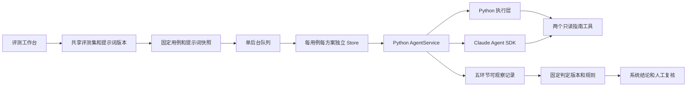

# 苟活评测工作台

工作台入口是完整应用的 `/workbench.html`，用产品账号登录。四个页签是评测集、批量运行与结果、提示词管理、自由测试。前端仍是独立的原生 HTML/JS，后端仍是 Python；不引入 Dify，也不增加外部评测平台依赖。

## 给测试者的操作顺序

1. 在评测集页选择“入门回归集”或新建评测集。填写名称和说明，添加用例。输入使用虚构场景，定义团队共享。
2. 每个用例填写名称、分类、记忆开关及步骤。可以只提问一次，也可以多轮续聊、另开会话、访问首页，或清空/删除/纠正测试记忆。另开会话保留本用例长期记忆；另一个用例始终全新。
3. 分别填写五环节和整体的判定条件，说明必须满足什么、禁止发生什么。参考答案可选，不要求字面一致。高级规则可检查指定步骤的状态、指南 ID、工具调用、摘要保存和记忆包含/排除文本。空白标准保持待确认。
4. 保存后产生评测集新版本。历史版本可查看；从历史保存会产生新的当前版本。删除用例或归档集不删除历史和运行记录。JSON 导入创建新集，导出包含完整用例与标准。
5. 勾选要运行的用例，进入批量页。选 A 的执行层和提示词组合；需要对比时启用 B。两方案共用一个固定判定提示词版本，适合比较执行层，或仅替换一个模块的提示词。
6. 提交后后台排队，页面显示进度。可离开页面，任务继续；重新登录后查看自己的任务。取消在当前用例结束后生效。接口返回 HTTP 401 / 402 时保留当前记录并中断剩余步骤和用例，检查凭据或补充余额后重跑。重启后未结束任务标为中断，可以按原快照全部重跑，或重跑系统非通过、人工非通过和未完成的用例。
7. 查看同用例 A/B 输出、五环节和独立整体结论。展开输入、真实指南工具结果、候选记忆、摘要及数据库前后状态；系统提供规则和证据索引。
8. 逐项选择人工通过/失败/待确认并填写依据。人工结论不覆盖系统结论，复核修改保留历史。JSON 导出包括快照、完整记录与复核；CSV 导出整体系统/人工结论、耗时及备注。

每集最多 200 例、每例最多 20 步、每批最多两个方案。一个后台队列顺序执行，同账号最多三个未完成任务，全系统最多二十个。不是多 worker / 分布式评测系统；模型调用、摘要和语义判定都会使用已配置的模型额度。

## 五环节与整体评测

| 环节 | 可观察的输入/输出 | 能判断的边界 |
|---|---|---|
| 理解问题 | 当前问题、有效记忆、已校验近期历史；模型显式输出 intent / explicit_facts / unknowns / scope | 任务标签和结论，不是私有思维链。缺失时待确认 |
| 检索指南 | 预召回候选标题、实际 search_entries 查询、get_entry 全文和工具状态 | 只能评价真实检索轨迹，标题不是来源 |
| 组织回复 | 本轮结构化状态/卡片及后端校验并渲染的答复 | 查看相关性、适用限制和备注，不将模型私有过程作为证据 |
| 提取记忆 | 本轮明确表达、有效旧摘要、已校验答复；模型候选状态/证据/主题/解决状态/咨询指南 | 候选与持久化结果分开。模型不能决定归属或绕过校验 |
| 会话摘要 | 同一整理输入、模型摘要字段、保存结果 | 摘要遗漏、错误背景及保存失败；记忆关闭时明确未运行 |
| 整体输入输出 | 用例全部步骤、实际答复和最终环境状态 | 独立依照整体条件判定，不计算五环节平均 |

前三个模块合成同一个主 Agent 提示词，记忆与摘要合成一个整理提示词。问答可能多次工具轮转；五项功能不是固定五次模型调用。语义判定另有一次无工具的SDK模型调用，使用固定 judge 版本，问答固定SDK，不提供执行层切换。

确定性规则先保留逐条结果；不满足的规则覆盖该环节的系统通过结论。文字条件由模型判定，须引用提供的证据键；格式无效、调用失败或无证据时待确认。整体执行失败直接判整体失败。对不可观察的理解过程，禁止从最终答复反推“理解正确”。系统判定仍可能错，测试者需复核；自动通过不等于选型或上线验收。

## 提示词文档、版本与产品启用

七个业务模块的初始文档在 `prompts/modules/`：understanding、retrieval、reply、memory、summary、home、judge。`prompts/contracts/chat.md` 与 `summary.md` 是另行维护的输出契约，组合同时固定契约全文；不在业务代码写提示词正文，也不开放契约的 GUI 改写。契约源码修改须同步后端校验、创建新组合并重新测试；导入组合采用本部署的契约，不能借导入绕过校验。`prompts/tools.json` 仍是两个只读工具的契约，不开放在工作台里动态扩权。SDK 工具权限不随提示词编辑放开。

首次部署由这些 Markdown 初始化不可变版本和初始启用组合。之后此部署的权威版本是运行卷 `prompts.sqlite`：编辑保存新版本、组合固定七个版本 ID、启用记录指向组合。仓库文件修改不会自动覆盖已有版本。工作台可导入单个 .md 到编辑器，再保存；导出单模块 .md、组合文档 .md 或组合 JSON。组合 JSON 可在另一部署导入为新版本与新组合，但不会自动启用。旧 `prompts/chat.md` / `summary.md` / `home.md` 保留无 registry 时的兼容调用入口，正式应用使用模块版本。

测试页使用选定组合的不可变快照，产品每次请求开始固定当前启用组合，问答和摘要共用这次快照。中途保存或启用新版本不会改变已提交批次。聊天提示词变化使旧短期会话失效，记忆管理 revision 继续保护删除/纠正。

编辑、测试、启用是三个独立操作。保存版本和组合不改变产品。新组合至少完成一个成功执行的评测用例后，才允许单独“启用到产品”；这是工作流约束，不证明所有模块已测或质量通过。启用前需查看实际样本和复核，填写原因。API 校验 expected_active，避免覆盖队友刚启用的版本。历史已启用组合可按同样方式回滚，启用记录保留作者和时间。

## 架构与隔离

`backend/prompts.py` 管版本、组合、差异与启用。`evaluation.py` 管用例校验、历史、任务快照、队列、规则/语义判定、复核和导出。`workbench.py` 管隔离会话及原自由测试；`model.py` 管业务调用和五环节观察。前端职责在 `evaluation.js` / `evaluation.css`，登录与自由测试仍在 `workbench.js`。

运行卷数据：产品 `memory.sqlite` 与账号文件；提示词 `prompts.sqlite`；评测定义/任务/结果/复核 `evaluations.sqlite`；自由测试会话与轨迹 `workbench/`；批量会话在 `evaluation-runs/{job_id}/workbench/`，自由测试不能续接这些会话。早期版本的批量测试记录保留并标记为 evaluation scope，从自由测试入口排除。共享的是虚构用例与提示词，个人运行、结果、复核及记忆只可由当前 owner 访问。登录 Cookie 决定 owner，客户端不能指定或伪造。

每次批量提交固定评测集版本和输入、七模块全文、判定版本、模型配置及指南/工具哈希。密钥只在服务进程内，不保存到任务快照。指南/工具变化时停止当前批次。重跑固定同一快照；配置模型名称变化须新建任务。跨重启若同名模型后端服务变化，仍不能保证供应商模型权重完全相同，应保留实验时间并核实提供方条件。

## API 供前端和团队 Agent 使用

接口均需登录 Cookie。修改采用 POST。普通请求上限 20 KB，评测集与提示词文档导入上限 2 MB。完整 JSON 格式可直接在工作台导出，无需猜字段。

| 接口 | 用途 |
|---|---|
| GET `/api/eval/datasets` | 共享集列表、六项环节和规则类型 |
| GET `/api/eval/datasets/{id}?version=1` | 查看指定不可变版本和历史；缺省当前版本 |
| POST `/api/eval/datasets` | `{name,description,cases}` 新建；更新附 `id,expected_version` |
| POST `/api/eval/archive` | `{id,expected_version}` 归档，不删历史 |
| POST `/api/eval/jobs` | `{dataset_id,dataset_version,case_ids,variants:[{runtime,bundle_id}],judge_version_id}` 异步提交 |
| GET `/api/eval/jobs` / `/{id}` | 个人任务、进度、系统/复核统计、快照及结果索引 |
| POST `/api/eval/jobs/{id}/cancel` | 当前用例后取消 |
| POST `/api/eval/jobs/{id}/rerun` | 原快照重跑；`failed_only:true` 重跑非通过和未完成 |
| GET `/api/eval/jobs/{id}/export` | 完整任务、结果、系统判定与复核 |
| GET `/api/eval/results/{id}` | 一次用例/方案完整结果 |
| POST `/api/eval/results/{id}/review` | `{stage,verdict,note}`，保留历史 |
| GET `/api/prompts` / `/versions/{id}` | 模块/版本/组合/启用历史及正文 |
| POST `/api/prompts/versions` | `{module,content,parent,note}` 保存新文档版本 |
| POST `/api/prompts/bundles` | `{name,versions:{七个模块:版本ID}}` 保存不可变组合 |
| GET `/api/prompts/bundles/{id}` | 全文导出快照 |
| POST `/api/prompts/import` | 导入导出的组合 JSON，不启用 |
| POST `/api/prompts/diff` | `{left,right}` 同模块两个版本的正文差异 |
| POST `/api/prompts/activate` | `{bundle_id,expected_active,note}` 单独启用或回滚 |

用例 steps 的 kind 是 chat / new_conversation / home / memory；chat 填 query；memory 的 action 是 clear / delete_last / correct_last / settings，纠正填 data.text 和可选 problem_status，设置填 data.enabled。criteria 按六环节标识保存文字标准。rules 每条是 `{stage,type,step,value}`，step 从 1 开始。verdict 是 pass / fail / pending。所有 source-of-truth 和限制以运行代码、校验及测试为准。

## 部署与验证

不加服务，沿用原 Compose 配置、项目名与数据卷。更新执行 `docker compose --env-file .env.compose up -d --build`。新表初始化和原测试 sessions 的 bundle 字段为增量迁移，不删除账号、产品记忆或旧测试结果；普通更新不删卷。真实模型、UI 与自动测试分别记录在 [验收记录](验收记录.md)。当前版本不提供生产 RBAC、分布式 worker、自动恢复中断中的模型调用或统计显著性计算。

2026-10-15 更新：新自由测试和批量方案统一 claude-sdk；A/B 仅比较提示词组合。旧 native 历史结果保持可读/可导出，不能续接或按旧native快照重跑，需新建SDK方案。SDK 原始恢复文件不作为观察证据或结果导出；五环节仅记录后端允许的输入输出与工具轨迹。
